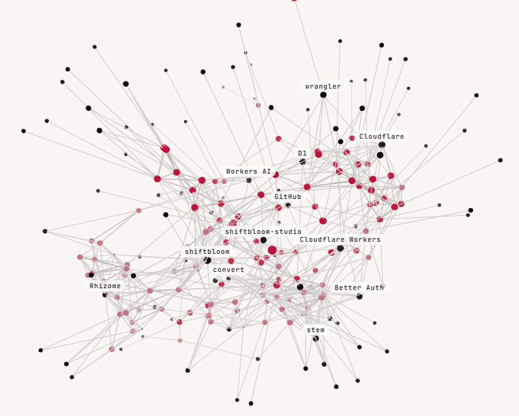

# rhizome.

Long-term memory for your AI agents. One shared memory across Claude, ChatGPT and friends, served over MCP from Cloudflare.



**License:** AGPL-3.0-or-later

rhizome is a long-horizon memory that belongs to a person, not to an agent. Claude, ChatGPT, Hermes, Cursor and your own agents all read and write the same memory, so each of them knows how you work, what you decided and what you prefer, whichever provider it comes from.

It was built for Cloudflare: one Durable Object per person, Vectorize for semantic search, R2 for the raw history and Workers AI for embeddings and reranking. There is no server, database or GPU to run yourself, and an idle memory costs only its storage.

The same code also runs on your own machine. `npm run local` or `docker compose up` starts it on Node with SQLite files and any OpenAI-compatible model server, such as Ollama or LM Studio. See [Run it without Cloudflare](#run-it-without-cloudflare).

> Status: version 1.0. Store and find, fact extraction with conflict resolution, nightly reflection, a 3D memory explorer and a remote MCP server for Claude, ChatGPT and other MCP clients work. The evaluation harness and the bi-temporal knowledge graph come next. See [Roadmap](#roadmap).

## Features

- One memory per person, shared by every agent and provider, split into scopes for the profile, each project and each agent's private notes.
- Hybrid recall: vector search, full-text search and recent items, fused and reranked, within a token budget.
- Notes are extracted from conversations in the background, compared with what is already known, and updated or marked as disputed. What you said yourself beats what an agent guessed.
- A nightly reflection recomputes importance, archives what is stale, merges duplicates and rewrites your profile and project summaries.
- A 3D memory explorer to search, confirm and forget memories.
- A remote MCP server with OAuth for Claude, ChatGPT and other MCP clients, plus API keys for Claude Code, Hermes and your own agents.
- Imports of `CLAUDE.md`, `AGENTS.md` and Hermes memory files.
- Runs on Cloudflare, or on your own machine with Node, SQLite and any OpenAI-compatible model server.

## How it works

```
agents (any provider) ─> gateway worker ─> one MemoryObject per person (SQLite)
                         auth, scopes       episodes, notes, blocks, FTS5, audit log
                                                 │
                         ┌───────────────────────┼───────────────────────┐
                         v                       v                       v
                   R2 raw episodes      outbox ─> Workers AI bge-m3 ─> Vectorize
                                                  (namespace = person, filter = scope)

recall: bge-m3 + Vectorize ─┐
        FTS5 / BM25 ────────┼─> reciprocal rank fusion ─> bge-reranker ─> token budget ─> context
        recent items ───────┘
```

* **The person is the unit.** Every person gets one Durable Object. It is the single writer for all their memory, so Claude and Hermes never race each other.
* **Scopes** split the memory:
  * `profile`: working style, preferences, values. Every agent reads it.
  * `project:<slug>`: decisions and conventions of one project.
  * `agent:<slug>`: private notes of one agent, invisible to the others.
* **Walls** keep one client's projects apart from another's. A wall is a name and a list of projects, set in the explorer. A walled project is searched only when the agent names it; a recall without a project leaves it out and tells the agent so. A conversation that was given memory from one wall gets nothing from another and is told to start a new one. Agents tell conversations apart with the `conversation` handle that `get_context` hands out while walls are set, or with their own session id; without one, the connector counts as inside a wall for 30 minutes after it last read from it. A fact learned in a walled conversation stays in its project, even when it is about you, whether the extractor, the agent's `remember` or `import_memory_file` filed it, and a conversation saved from behind a wall is stored inside it: where it wanted to go waits in the explorer's held list until you release it. Walls are off until you set one, and a project outside every wall behaves as before.
* **Ledger** (on by default, `LEDGER=off` turns it off) remembers which connector was given which memory through `get_context` or `recall`. When such a memory is later replaced, or you delete it, exactly the connectors that were given the old version are told once, at the top of their next `get_context` or `recall`: the old and the new wording for a replacement, only the id for a deletion. Connectors that never saw the old version hear nothing, a duplicate folded into another note is no news, and a change is only told to a call that may read it. The explorer API's item detail lists who was given it. Recall as of a past time, the REST API and the explorer are not recorded.
* **Open loops** (on by default, `OPEN_LOOPS=off` turns them off) are things an agent should come back to, such as a follow-up you asked for. An agent opens one with `open_loop`, optionally with a due date. Before that date the loop stays quiet; from then on `get_context` for its scope leads with a short *Due now* section (the soonest five, the rest counted) until an agent closes it with `close_loop`, optionally with what came of it. A loop without a date is due the next time its scope is loaded. Due is decided when context is read, so nothing runs in the background and no model is called. Loops follow scopes and walls like notes, can be forgotten by id and are part of the export.
* **Standing orders** (on by default, `STANDING_ORDERS=off` turns them off) are rules you gave once, such as "never close GitHub issues", stored as data: a few clauses on tool names and fields of a call, each with `deny`, `ask` or `warn`. Agents see the active ones at the end of `get_context`. rhizome also answers a check for one tool call, so a harness with a pre-tool-call hook (Claude Code, Codex, Cursor, Gemini CLI) can stop a call before it runs. Without such a hook an order is a written rule, and an agent can still break it. An order an agent writes without your own words waits as proposed until you activate it in the explorer, and only you can disable or delete one. See [docs/standing-orders.md](docs/standing-orders.md).
* **Clients** are agents of a provider (`claude-code` by `anthropic`, `hermes` by `nous`). Each has its own API key and grants that say which scopes it may read and write. Every memory records which agent, provider and model wrote it.
* **Lossless at the bottom.** Episodes are stored verbatim in R2. Chunks, notes and vectors are derived and can be rebuilt, for example after switching the embedding model.
* **Cheap reads.** Recall uses no generative model: an embedding, a vector query, SQLite full-text search and a small reranker.
* **Trust levels** on notes (`user_explicit`, `user_confirmed`, `agent_inference`, `tool`) feed ranking and conflict resolution: what you said yourself beats what an agent guessed.

## What happens in the background

Everything runs inside the person's Durable Object, triggered by its alarm, with Workers AI models by default.

1. **Extraction.** A few seconds after an episode arrives, DeepSeek V4.1 Flash turns it into short English notes (preference, decision, fact, learning) with a scope, a trust level, when the fact started and ended if the episode says so, and the people, projects and tools it mentions. An episode without user messages can never produce a note that claims the user said something.
   * Memory comes first: the up to 12 stored notes most related to the episode (full-text search plus the stored embeddings) go into the same prompt, and the model labels each fact *new*, *same*, *update* or *contradiction* against them.
2. **Resolution.** A labelled fact is applied directly when the two notes really overlap, since a merge drops the new wording and an update against the wrong note would hide it. Facts without a usable label are compared with the notes of their scope using the embeddings stored next to them, so nothing waits for the vector index.
   * At a similarity of 0.93 or more it is the same fact: the existing note gains a confirmation, and keeps the higher of both trust levels.
   * Between 0.78 and 0.93 a second model call decides between *same*, *update*, *contradicts* and *new*.
   * An update replaces the old note (`superseded`), and recall follows the chain to the current version. The old note is never overwritten: its validity ends where the new one starts (`valid_from` / `valid_to`), and `expired_at` records when rhizome stopped treating it as current, so the history of how a memory changed stays readable.
   * A guess never replaces what the person said. Such a conflict is stored as `disputed` and shown in the explorer for review, where confirming one side settles it.
3. **Linking.** New notes get `similar` edges to their nearest neighbours. Notes written directly through the API are merged with an existing equal note, or linked.
4. **Records.** Unless `RECORDS=off`, every note is also filed as a row of a table: its type (event, state, preference, other), a category (the generic word for what it is about, such as `wedding`, `bike repair` or `musical instrument`), up to three broader tags, an amount with its unit and the date it happened, if the note says so. Llama 4 Scout files 20 notes per call, four calls at a time, and is shown the categories already in use so the same kind of thing keeps one name (`RECORDS_MODEL` picks another model). The note stays the source of truth: when its text changes or it is deleted, its row goes, and the note is filed again. A batch the model cannot file twice is tried again a day later. Recall uses the rows (step `records`), and so does the `query_records` tool. On the first start after the upgrade, existing notes are filed in the background, and every vector is written to Vectorize once more from its stored embedding (no model calls), so it carries its event day for `VECTOR_FILTERS`.
5. **Reflection**, nightly at 03:17 UTC and on demand:
   * Importance is recomputed from trust, confirmations, recall count and a decay whose half-life depends on trust (a year for what you said, two months for an agent's guess).
   * Episode chunks that are older than a year, were never recalled and are unimportant are archived. Their raw episode stays in R2.
   * Duplicates the day produced are merged.
   * Unless `DISPUTE_RESOLUTION=off`, disputed notes are settled over time. What you said or confirmed wins over a guess, and of two things you said the later one wins. The remaining pairs, at most 20 a night, go to the extraction model in one request, which says whether the newer note replaces the older one (something changed, or an open question got answered), the newer one is wrong, both hold, or it can't tell; a pair it can't tell waits a week. A note replaced over time keeps its history and its validity ends where the newer one starts; a note that was wrong only expires. Every settled pair is in the activity log as `dispute.settle`.
   * GLM 5.3 rewrites the `distilled-profile` block from the profile notes, and a `summary` block for each changed project. It only runs when the notes changed.

Set `EXTRACTION=off` to store episodes without extraction (disputes are then only settled where trust decides), and `EXTRACTION_MODEL` or `REFLECTION_MODEL` to use other Workers AI models. At most `EXTRACTION_DAILY_LIMIT` episodes (default 200) per person and UTC day go through extraction; the rest are stored and searchable without extracted notes.

## Memory explorer

The web UI at `/` shows the memory as a 3D graph.

* Notes are coloured by trust, and their size follows importance.
* Conversations and the people, projects and tools they mention are nodes too.
* Search runs the same hybrid recall as the agents and shows the scores and sources of every result.
* A detail panel shows where a memory came from, what it replaced and what contradicts it. From there you can confirm or forget it, everywhere.
* You can also write notes about yourself, and start a reflection.

The explorer opens the memory of the person whose email address matches the signed-in user. `AUTH_MODE` picks how people sign in:

| `AUTH_MODE` | Sign-in | Settings |
| --- | --- | --- |
| `access` (default) | [Cloudflare Access](https://developers.cloudflare.com/cloudflare-one/applications/) in front of rhizome. The app checks the Access token itself as well | `ACCESS_AUD`, `ACCESS_TEAM_DOMAIN` |
| `password` | rhizome's own sign-in page for one person, with a signed cookie that lasts a week. The person is created on the first sign-in | `LOGIN_EMAIL`, `LOGIN_PASSWORD` (12+ characters), `SESSION_SECRET` (32+ characters) |
| `proxy` | A sign-in proxy you already run, such as Authelia, oauth2-proxy or Tailscale Serve, passes the email address in a header | `PROXY_AUTH_HEADER`, `SESSION_SECRET`, and `PROXY_AUTH_SECRET` (32+ characters, sent by the proxy as `x-rhizome-proxy-secret`) or, on Node only, `PROXY_TRUSTED_IPS` |

Until the chosen mode is fully configured, the explorer API answers 404 and nobody can approve an OAuth connector. The same sign-in protects the OAuth consent page. In password mode, sign-in attempts are limited to 10 a minute per address, and changing `LOGIN_EMAIL`, `LOGIN_PASSWORD` or `SESSION_SECRET` signs every session out.

## MCP

`https://<your host>/mcp` is a remote MCP server (Streamable HTTP, stateless). It has six tools:

| Tool | What it does |
| --- | --- |
| `get_context` | Profile, working style and, with a `project`, its summary and most trusted notes. For the start of a task |
| `recall` | Hybrid search across the profile, the agent's own notes and every project it may read, or one `project`. Optional `queries` (other wordings or parts of the question), a `from`/`to` time range and `as_of` |
| `remember` | Stores one note. `said_by_user: true` marks it as something the person said, which wins conflicts |
| `save_conversation` | Stores a conversation verbatim; notes are extracted from it in the background |
| `import_memory_file` | Imports a `CLAUDE.md`, `AGENTS.md`, Hermes `MEMORY.md` or `USER.md`, or any Markdown notes. Each bullet or paragraph becomes a note, and a second import of the same file adds nothing |
| `forget` | Deletes a note or a conversation by id |

With `OPEN_LOOPS=on` it also lists `open_loop` (something to come back to, with an optional `due` date) and `close_loop` (by id, with an optional `outcome`).

With `RECORDS=on` (the default) it also lists `query_records`: every note filed under a kind of thing, with date, amount and source episodes. Give a `category` or a `query` (the categories it asks for are picked), an optional `type` and `from`/`to`, and `op` `list`, `count`, `sum` (per unit, saying how many rows have no amount) or `latest`. The rows always come along, so an agent can check what a total is made of.

With `STANDING_ORDERS=on` there are three more: `standing_orders` lists the active orders, `check_tool_call` checks a call an agent is about to make, and `add_standing_order` stores a rule the person gave ([docs/standing-orders.md](docs/standing-orders.md)).

**Usage analytics** (`MCP_ANALYTICS=on`, off by default) sends one anonymous event per tool call and per `initialize` to a PostHog project, in the shape of PostHog's MCP analytics, so its MCP dashboards show call volume, error rates and latency per tool. An event holds the tool name, whether it failed (`validation` or `internal`), the time it took, the size of the answer and the client software's name and version. While it is on, every tool also offers an optional `intent` argument with a fixed list of reasons (`task_start`, `answer_question`, `save_decision` and so on, see `INTENTS` in `src/mcp.ts`); the chosen value is sent as `$mcp_intent`, free text never is. When a call passes `conversation`, a SHA-256 hash of the connector id, the UTC day and that handle is sent as `$mcp_conversation_id`, so PostHog can group the calls of one conversation; the handle itself is not sent. It never holds memory content, queries, tool arguments or results, project or scope names, user or client ids, emails or keys. Calls are counted per connector under a pseudonym that changes every UTC day, no person profiles are created and GeoIP is off. Set `POSTHOG_HOST` (for example `https://eu.i.posthog.com`) as a build variable and the project API key as the secret `POSTHOG_KEY`. Events are sent after the answer, so a slow or unreachable PostHog never delays a memory call. When it is on, the privacy page names PostHog.

**Feature flags from PostHog** (`POSTHOG_FLAGS=on`, off by default) let you switch `LEDGER`, `STANDING_ORDERS`, `OPEN_LOOPS`, `DISPUTE_RESOLUTION` and `RECORDS` in PostHog instead of redeploying. All five are on by default. Create boolean flags named `rhizome-ledger`, `rhizome-standing-orders`, `rhizome-open-loops`, `rhizome-dispute-resolution` and `rhizome-records`. A var that is set in the environment always wins, so `LEDGER=off` stays a kill switch; only unset vars take the flag's value, and a disabled flag turns its feature off. Flags are evaluated for the whole deployment with one fixed id, so they don't target single people, and nothing about anyone is sent. Values are cached for a minute per isolate. If PostHog is slow (over 1.5 s) or unreachable, or a flag is missing, an unset var is on. Set `POSTHOG_FLAGS=on` as a build variable; it uses the same `POSTHOG_KEY` and `POSTHOG_HOST` as usage analytics. See `src/flags.ts`.

There are two ways to connect.

* **OAuth**, for Claude, ChatGPT and any client that adds a server by URL. Add `https://<your host>/mcp` as a custom connector. The client registers itself, and you approve it on a consent page that needs you signed in. There you choose the agent and provider names its notes are signed with. Approving creates a client with the default grants, or reuses the one you already have for that agent and provider. Access tokens are API keys that expire after an hour and are refreshed automatically, so revoking the client in your token manager ends the connection.
* **API key**, for Claude Code, Hermes and other clients that can send a header:

```sh
claude mcp add --transport http rhizome https://memory.example.com/mcp --header "Authorization: Bearer $RHIZOME_KEY"
```

## API

All memory endpoints take `Authorization: Bearer <client api key>`.

| Method | Path | Purpose |
| --- | --- | --- |
| `POST` | `/v1/memory/episodes` | Store a conversation turn or any text (`messages` or `text`, optional `scope`, `sessionId`, `model`, `tEvent`) |
| `POST` | `/v1/memory/notes` | Store a note (`content`, `kind`: preference, decision, fact, learning, note; `trust`) |
| `POST` | `/v1/memory/recall` | Hybrid search (`query`, optional `scopes`, `project`, `limit`, `budgetTokens`, `queries`, `from`, `to`, `asOf`, `features`) |
| `GET` | `/v1/memory/context` | Cache-friendly core for a system prompt: blocks plus the most trusted notes. Supports `ETag` |
| `GET` | `/v1/memory/blocks` | List working-memory blocks |
| `PUT` | `/v1/memory/blocks/:label` | Create or replace a block (`scope`, `value`, `charLimit`) |
| `GET` | `/v1/memory/episodes` | List episodes, newest first |
| `GET` | `/v1/memory/episodes/:id` | Raw episode from R2 |
| `DELETE` | `/v1/memory/items/:id` | Forget a note or a whole episode, everywhere |
| `POST` | `/v1/memory/import` | Import a memory file (`content`, `format`: claude-md, hermes, markdown; optional `scope`, `kind`, `trust`, `fileName`) |
| `GET` | `/v1/memory/export` | Page through everything the client may read |
| `GET` | `/v1/memory/stats` | Counts and database size |
| `GET` | `/v1/memory/me` | The calling client and its grants |

Recall leaves out superseded and archived notes, and returns disputed ones with a lower score. Every result carries a `confidence` between 0 and 1. A `from`/`to` range (ISO dates; a date as `to` includes that day) limits recall to memories from that time and scores their stored embeddings exactly.

`asOf` (`as_of` on MCP) answers as of a past date or time: notes that were true then, including ones replaced since, and conversation excerpts from before it. A date means the end of that day.

Set `CHUNKING=rounds` to cut new conversations into rounds (a question with its answers, short rounds joined) instead of fixed 1,200-character excerpts.

Recall runs the steps below. The `RECALL_FEATURES` variable (comma separated, `all` or `none`) or `features` on a request names fewer; without the variable all of them run, and `features: []` runs a single request without them. The Cloudflare config in `wrangler.jsonc` sets `RECALL_FEATURES=all` together with `CHUNKING=rounds`:

* `abstain`: returns nothing (`abstained: true`) when no result shares a keyword with the query and none is semantically close.
* `diversity`: at most one excerpt per conversation, and near-identical results make room for different ones.
* `evidence`: a note brings the conversation excerpt it was extracted from, when the token budget allows.
* `keys`: conversation excerpts are also found through the facts extracted from them. New extractions file each fact under its excerpt; nightly reflection fills in older episodes.
* `time`: English and German time words in the query ("last week", "letzten Monat", "im März", "vor 3 Tagen", "since Monday") become a time window. When nothing falls inside it, recall runs without it.
* `records`: when the query asks for a kind of thing ("how many weddings did I go to", "what instruments do I own"), every note filed under it comes along as a list, oldest first, with its date and amount, not only the few most similar ones. A category or tag counts as asked for when its embedding is at least 0.6 similar to the query's and within 0.05 of the best label, and a category also when the query names it and it is at least 0.45 similar; at most three labels. A time window limits the list by when things happened. The list takes at most 35 % of the token budget and 25 rows, and says how many rows are on file. It costs no model call: the labels' embeddings are stored when they are first used.
* `turns`: conversations come back as turn cards. The ten best conversations (by their best excerpt) are split into turns, and the turns and the notes found are scored one by one, so the best of them fill the token budget, with no cap per conversation. Each conversation is one result with its picked turns in order (`parts`, joined in `content`), and results come in the order things happened. A user turn shows up to 1,500 characters; of a reply, the two sentences that share the most words with the query. It costs one more reranker call per recall (up to 200 turns). `cards: false` returns plain excerpts instead.

```sh
# remember something about yourself
curl -X POST https://memory.example.com/v1/memory/notes \
  -H "Authorization: Bearer $RHIZOME_KEY" -H "Content-Type: application/json" \
  -d '{"scope":"profile","kind":"preference","trust":"user_explicit","content":"Use the AGPL-3.0-or-later license for every project."}'

# ask from any other agent
curl -X POST https://memory.example.com/v1/memory/recall \
  -H "Authorization: Bearer $RHIZOME_KEY" -H "Content-Type: application/json" \
  -d '{"query":"Which license should this repo use?","budgetTokens":800}'
```

Admin endpoints (`/v1/admin/users`, `/v1/admin/clients`) create people and agent clients, and `PATCH /v1/admin/users/:id` with `{"email": "..."}` links a person to the address they sign in to the explorer with. They take `Authorization: Bearer <ADMIN_TOKEN>` and are disabled when no `ADMIN_TOKEN` secret is set.

### API keys

A client can hold several keys, each with an optional label and expiry date. Keys are stored as SHA-256 hashes; the plain key is returned once. A key is refused as soon as its expiry has passed or it is revoked.

| Method | Path | Body |
| --- | --- | --- |
| `POST` | `/v1/admin/clients` | `userId`, `agent`, `provider`, optional `name`, `grants`, `label`, `expiresAt` |
| `POST` | `/v1/admin/clients/:id/keys` | optional `label`, `expiresAt` (epoch ms or ISO date) |
| `GET` | `/v1/admin/clients/:id/keys` | – |
| `DELETE` | `/v1/admin/clients/:id/keys/:prefix` | – (prefix = first 10 characters of the key) |

[field](https://github.com/shiftbloom-studio/field) offers the same through a screen, using a D1 binding to `rhizome-control`.

## Tech stack

- TypeScript on [Hono](https://hono.dev), bundled with esbuild. The explorer in `web/` has its own build.
- Cloudflare Workers with Durable Objects (SQLite), D1, R2, Vectorize, Workers AI, static assets, rate limiting and a Cron Trigger
- Node.js 26 for builds and tests, and as a second runtime with `node:sqlite` and any OpenAI-compatible model server, also as a Docker image
- Vitest for tests. `npm run check` runs the typecheck, the explorer build and a dry-run deploy.

## Self-hosting

rhizome runs in two places. Both use the same code, API and MCP server.

| | Cloudflare | Node (your machine, a VPS, a homelab) |
| --- | --- | --- |
| Memory per person | Durable Object with SQLite | SQLite file in `DATA_DIR/memory/` |
| Control plane | D1 | `DATA_DIR/control.sqlite` |
| Raw episodes | R2 | files in `DATA_DIR/episodes/` |
| Semantic index | Vectorize | exact cosine search, `DATA_DIR/vectors.sqlite` |
| Models | Workers AI | any OpenAI-compatible server (Ollama, LM Studio, llama.cpp, vLLM, OpenAI), or Workers AI over REST |
| Nightly reflection | cron trigger | timer in the process |

The Node version uses small stand-ins for the Cloudflare bindings (`src/node/`), so nothing in the memory logic differs. It is meant for one person or a small group: vector search scans every vector of a person, which is quick for tens of thousands of memories.

### Run it without Cloudflare

You need Node 26 or Docker, and a model server for embeddings and extraction. These steps use [Ollama](https://ollama.com).

**With Docker**

```sh
cp .env.example .env          # set LOGIN_EMAIL, LOGIN_PASSWORD, SESSION_SECRET and ADMIN_TOKEN
docker compose up -d
docker compose exec ollama ollama pull bge-m3
docker compose exec ollama ollama pull qwen3:8b
```

**With Node**

```sh
ollama pull bge-m3 && ollama pull qwen3:8b
cp .env.example .env          # same settings as above
npm run setup
npm run local                 # builds the explorer and the server, then starts on http://localhost:8787
```

Open http://localhost:8787 and sign in with `LOGIN_EMAIL` and `LOGIN_PASSWORD`. The first sign-in creates you as a person. To connect an agent, add `<PUBLIC_URL>/mcp` as an MCP server and approve it (OAuth), or create a client with an API key through the admin API as in step 4 below. Your user id for that is `userId` at http://localhost:8787/ui/api/me while you are signed in.

Things worth knowing:

* **Models.** `EMBEDDING_MODEL` and `EXTRACTION_MODEL` must be models your server serves. `bge-m3` matches the Worker's embeddings. Any chat model that writes JSON reliably works for extraction; smaller ones miss more facts. `EXTRACTION=off` stores conversations without extracting notes. `AI_PROVIDER=cloudflare` with `CLOUDFLARE_ACCOUNT_ID` and `CLOUDFLARE_API_TOKEN` uses Workers AI and its default models from Node.
* **Reranking** is optional: point `AI_RERANK_URL` at a `/rerank` endpoint (llama.cpp with `--reranking`, vLLM, TEI or Infinity). Without it, recall keeps the fused order of vector and full-text search.
* **Reachable from elsewhere.** rhizome listens on `127.0.0.1` unless you set `HOST`. Put a reverse proxy with TLS in front (Caddy, nginx, Traefik) and set `PUBLIC_URL` to its address, because OAuth for Claude and ChatGPT needs an `https` URL they can reach. With `TRUST_PROXY=true` rhizome takes the client address from the last `X-Forwarded-For` entry, the one your proxy added; only set it when the proxy is the only way in.
* **Sign-in.** `AUTH_MODE=password` needs nothing else. With `proxy`, rhizome only believes the email header when the proxy also sends `PROXY_AUTH_SECRET`, or when the connection comes from an address in `PROXY_TRUSTED_IPS` (the TCP peer, never a header). Use the address list for proxies that can't add headers, such as Tailscale Serve. A Cloudflare Tunnel with Access works too: keep `AUTH_MODE=access`.
* **Backups.** Everything lives in `DATA_DIR`. Stop the server, or use `sqlite3 .backup`, and copy the folder.

### Run it on Cloudflare

You need a Cloudflare account with Workers Paid and a zone for the hostname.

1. **Create the resources**

   ```sh
   npm install
   npx wrangler d1 create rhizome-control
   npx wrangler r2 bucket create rhizome-episodes
   npx wrangler vectorize create rhizome-memory --dimensions=1024 --metric=cosine
   npx wrangler vectorize create-metadata-index rhizome-memory --propertyName=scope --type=string
   npx wrangler vectorize create-metadata-index rhizome-memory --propertyName=kind --type=string
   # optional, for VECTOR_FILTERS=on (recall in a time window asks Vectorize for those days too)
   npx wrangler vectorize create-metadata-index rhizome-memory --propertyName=day --type=number
   ```

2. **Fill in your settings.** `wrangler.jsonc` is a template with placeholders. Copy `.env.deploy.example` to `.env.deploy` and set your hostname and the D1 database id. Optional settings are the Access application of the explorer and the operator details for `/imprint` and `/privacy`; both pages answer 404 without them. `npm run deploy` renders everything into `wrangler.deploy.jsonc`, which is not committed. To deploy from Workers Builds instead, see [Deploy with Workers Builds](#deploy-with-workers-builds).

3. **Deploy**

   ```sh
   npm run setup
   npm run migrate
   npm run deploy
   npx wrangler secret put ADMIN_TOKEN    # any long random string
   ```

4. **Create yourself and your agents**

   ```sh
   curl -X POST https://memory.example.com/v1/admin/users \
     -H "Authorization: Bearer $ADMIN_TOKEN" -d '{"name":"me"}'
   curl -X POST https://memory.example.com/v1/admin/clients \
     -H "Authorization: Bearer $ADMIN_TOKEN" \
     -d '{"userId":"<id from above>","agent":"claude-code","provider":"anthropic"}'
   ```

   The response contains the client's API key once. Repeat for every agent.

5. **Protect the explorer.** Without Cloudflare Access, set `AUTH_MODE=password` and `LOGIN_EMAIL` as build variables and `LOGIN_PASSWORD` and `SESSION_SECRET` as secrets, and skip the rest of this step. With Access, create a Cloudflare Access application for your hostname. Add a second one with a Bypass policy for `/v1/*`, `/mcp`, `/.well-known/*`, `/oauth/token`, `/oauth/register`, `/oauth/revoke`, `/privacy`, `/datenschutz`, `/imprint`, `/impressum`, `/fonts/*` and `/favicon.svg`, so agents, MCP clients and the legal pages stay reachable. Agents still need their API key or OAuth token. Leave `/oauth/authorize` behind Access: that is where you approve a connector. Then set `ACCESS_AUD` (the application's audience tag) and `ACCESS_TEAM_DOMAIN`.

If your zone challenges bots, add a WAF skip rule for requests to your hostname that carry an `Authorization` header, otherwise agents get a challenge page instead of JSON.

### Deploy with Workers Builds

A rhizome Worker can deploy with Workers Builds on every push to `main`, and no API token is stored on GitHub. Connect the repository to the Worker in the Cloudflare dashboard (Settings > Build) and set the names from `.env.deploy.example` as build variables. Use `npm ci && npm ci --prefix web && npm run build:web && npm run config` as the build command and `npx wrangler deploy -c wrangler.deploy.jsonc` as the deploy command. The build picks up Node 26 from `.node-version`.

## Costs

On Node the costs are your machine's. On Cloudflare, measured list prices on Workers AI and Vectorize (November 2026). An idle memory costs only storage, roughly $0.20 a month after a year of heavy use. Active use is dominated by fact extraction, about $0.0006 per short episode with DeepSeek V4.1 Flash, and by the nightly reflection, which only calls GLM 5.3 when notes changed. Filing records costs about 4 neurons per note with Llama 4 Scout (measured on a batch of ten). Details in [docs/m0-spike.md](docs/m0-spike.md).

## Roadmap

| Milestone | Scope |
| --- | --- |
| M0 | Spike: model comparison, FTS5 in Durable Objects, Vectorize latency ([results](docs/m0-spike.md)) |
| M1 | Store and find: gateway, MemoryObject with scopes, R2, Vectorize, hybrid recall, API keys |
| **0.2** | **First parts of M4, M6 and M9: extraction with conflict resolution, links, decay, nightly reflection, 3D memory explorer behind Access** |
| **M2** | **Remote MCP server with OAuth for Claude, ChatGPT and other MCP clients; import of CLAUDE.md and Hermes memory files (0.3)** |
| M3 | Evaluation harness (LongMemEval, LOCOMO, own data) in CI. LongMemEval retrieval runs from [`bench/`](bench/README.md) |
| M4 | Fact extraction and update resolver (add, update, invalidate) via Queues |
| M5 | Bi-temporal knowledge graph, entity resolution, as-of queries |
| M6 | Reflection and dreaming: profile distillation, decay, communities, block rewriting |
| M7 | Retrieval v2: query planning, deep mode, feedback |
| M8 | Procedural memory (skills) and a Hermes memory provider plugin |
| M9 | Memory explorer UI and a memory proxy for any OpenAI- or Anthropic-compatible client |
| M10 | Hosted version and control plane |

## Contributing

Issues and pull requests are welcome. Start with [CONTRIBUTING.md](CONTRIBUTING.md).

## Security

Please don't report vulnerabilities in public issues. Use GitHub's private vulnerability reporting on this repository or email [safety@shiftbloom.studio](mailto:safety@shiftbloom.studio). [SECURITY.md](SECURITY.md) has the details.

## License

Copyright © 2026 shiftbloom studio and contributors.

rhizome is free software under the [GNU Affero General Public License](LICENSE), version 3 or (at your option) any later version (`AGPL-3.0-or-later`). If you run a modified version as a service, you share your changes under the same license.

---

rhizome is part of [shiftbloom studio](https://shiftbloom.studio), an open studio from Hamburg. All of our apps are open source at [github.com/shiftbloom-studio](https://github.com/shiftbloom-studio).
